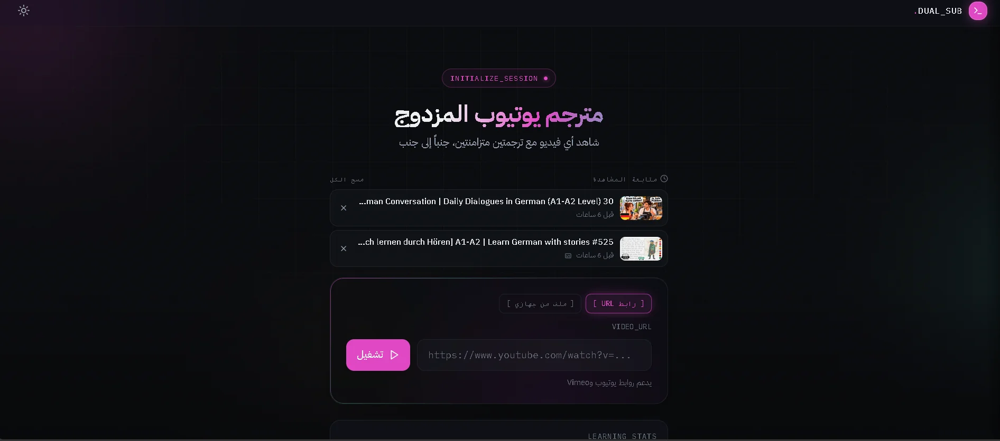
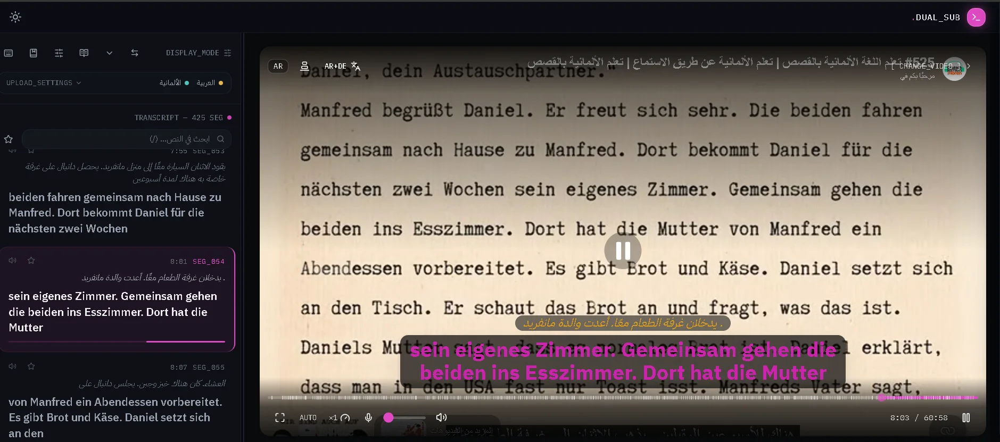
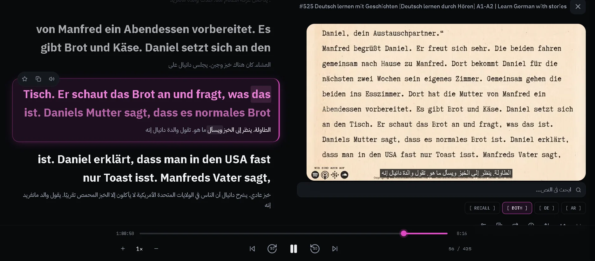
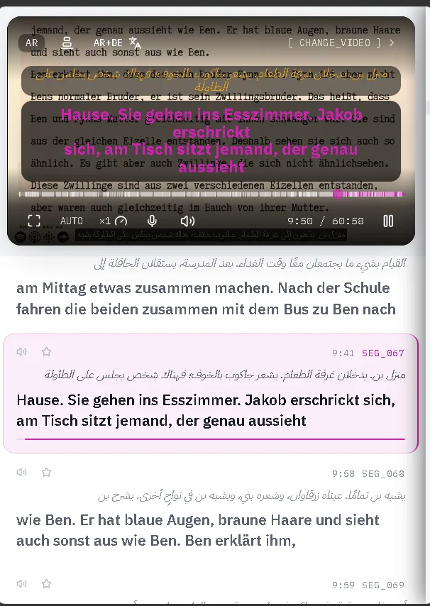

# DUAL_SUB — Dual-Subtitles Video Player

> **YouTube • Vimeo • Local video** — two synchronized subtitle tracks on one timeline. Read along, look up words,
> and review what you learn. Everything runs in your browser: no backend, no account, no API keys.

## Built with

<p align="center">
  
</p>

<p align="center">
  
  
  
  
  
  
  
  
</p>

<p align="center">
  
  
  
  
  
  
  
</p>

## Screenshots

| Start screen | Player with dual subtitles | Reading mode | Mobile player |
|---|---|---|---|
|  |  |  |  |

*Screenshots show public German-learning videos from YouTube; video content belongs to its creators.*

## About the project

**DUAL_SUB** (`youtube-dual-subtitles`) is a client-side React application that plays YouTube, Vimeo or local
video files with **two synchronized subtitle tracks** — for example the original language and its translation —
and turns every word into a clickable dictionary entry you can save and review later.

Language learning from video is usually limited to one subtitle track, or none. You cannot see the original text and
its translation together, look a word up without leaving the player, or review what you learned afterwards. DUAL_SUB
addresses all three.

It is **local-first**: no backend, no database, no analytics, no login, no API keys. Settings, watch history,
subtitle files and vocabulary live in `localStorage` and `IndexedDB`, inside your browser, and can be exported as
one JSON backup.

> [!NOTE]
> The interface is currently **Arabic and right-to-left (RTL)**; translating it is planned (see
> [Future additions](#future-additions)).

### Main features

- **Dual subtitles** on the video: each line has its own colour, size and position, and drags independently.
- **Three video sources**: YouTube, Vimeo, or a local file that never leaves your device.
- **Subtitle formats**: `.srt`, `.vtt`, `.ass`/`.ssa`, and bilingual single files split into two tracks (2 MB cap).
- **Syncing**: nudge each track, or use two-point sync to fix drifting subtitles; offsets are remembered per video.
- **Reading mode**: a lyrics-style list that follows the audio and highlights the word being spoken.
- **Vocabulary and review**: click a word for its meaning, save it with its sentence, then review it with
  spaced repetition; export to CSV or Anki Cloze. German adds article, plural, verb forms and lemma.
- **Study tools**: recall mode, shadowing mode, line repeat, bookmarks, text-to-speech, playback speed up to 2×.
- **Installable PWA** that works offline once loaded, with light and dark themes checked for WCAG AA contrast.
- **Touch-friendly interface**: icon buttons keep ~44 px tap areas on touch screens, rarely used actions sit in a
  "more options" menu, clearing the watch history asks for confirmation, and the interface accent can optionally follow
  the subtitle colour (off by default).

The full feature table is in [docs/guide/features.md](docs/guide/features.md).

### Run it locally

Requires Node.js 22.13 or newer 22.x and npm 10 or newer.

```bash
npm ci          # install the exact locked dependencies
npm run dev     # start the dev server at http://localhost:5173
```

| Command | What it does |
|---|---|
| `npm run typecheck` | TypeScript type-check (app and Vite config) |
| `npm run lint` | ESLint 10, warnings are errors |
| `npm run lint:strict` | Stricter react-hooks rules; the count per rule may not grow past its recorded baseline |
| `npm test` | Vitest unit and integration tests |
| `npm run build` | Type-check, then production build |
| `npm run build && npm run budget` | Fail if the first-page JavaScript/CSS or a lazy chunk exceeds its gzip budget |
| `npm run build && npm run e2e` | Real-Chrome accessibility, CSP and layout check (needs Chrome, see `CHROME_PATH`) |

### More documentation

- [Getting started](docs/guide/getting-started.md), [usage and shortcuts](docs/guide/usage.md), [performance ledger](docs/guide/performance-ledger.md),
  [privacy and storage](docs/guide/privacy-and-storage.md), [deployment](docs/guide/deployment.md)
- [Technology stack and project structure](docs/guide/project-structure.md),
  [testing and performance](docs/guide/testing-and-performance.md), [contributing](docs/guide/contributing.md)
- [Architecture overview](docs/ARCHITECTURE.md): how it works, security, lessons learned
- AI-assistant setup (rules, skills, agents, hooks): [`CLAUDE.md`](CLAUDE.md) and [`.claude/`](.claude/README.md)

Released under the [MIT License](LICENSE).

## Future additions

None of these is implemented yet. They are listed in a suggested order of priority.

**Quality and accessibility**
- [ ] Run `e2e:screens` in CI and extend it to the upload screens (CI currently runs only `npm run e2e`).
- [ ] Turn on the stricter React-hooks rules of `eslint-plugin-react-hooks` 7 (`refs`, `set-state-in-effect`,
      `purity`) in a dedicated change.
- [ ] Automated verification of the Anki export against a real Anki import.

**Product**
- [ ] Interface translation (the UI is currently Arabic/RTL only).
- [ ] Grammar reader for more languages (French, Spanish, Italian, Dutch, …); German is done.
- [ ] Optional offline German dictionary built from Wiktionary data (no per-click request).
