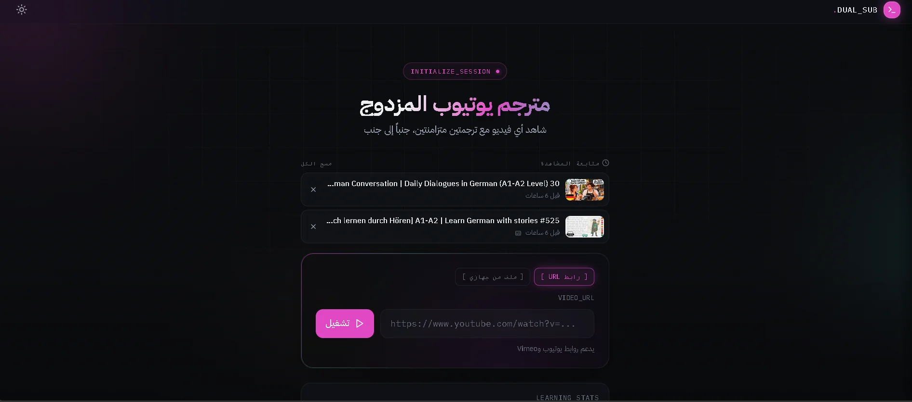
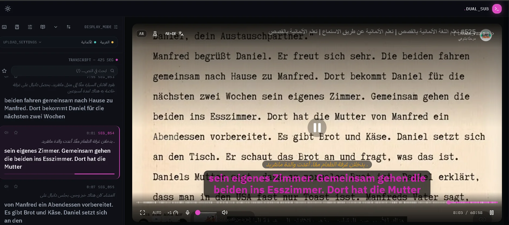
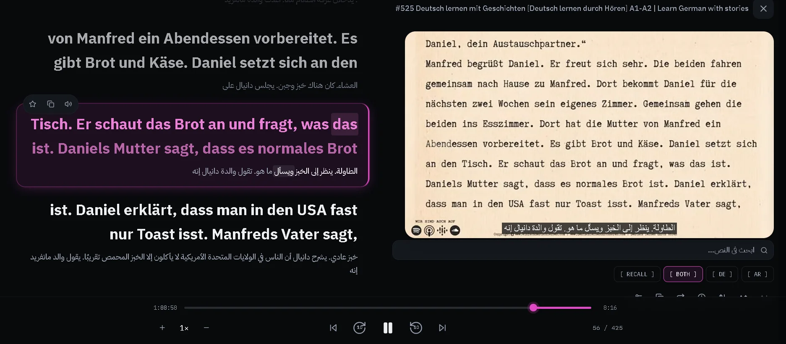
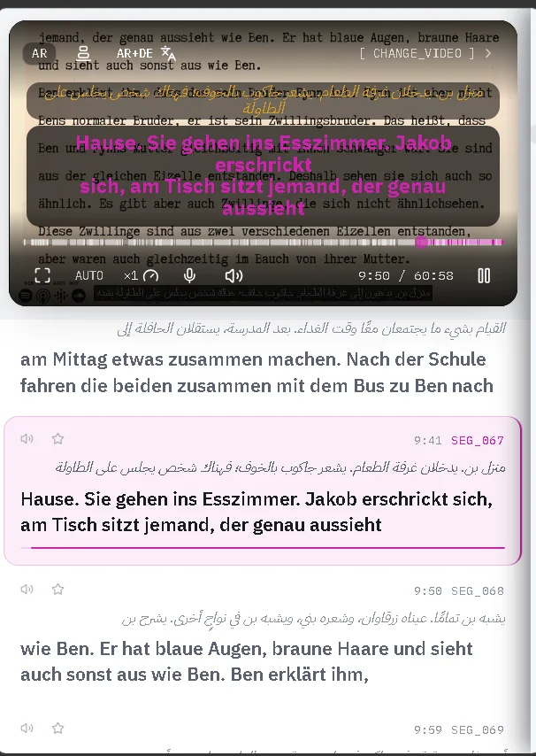

# DUAL_SUB — Dual-Subtitles Video Player

<p align="center">
  <a href="https://skillicons.dev">
    
  </a>
</p>

<p align="center">
  
  
  
  
  
  
  
  
</p>

> **YouTube • Vimeo • Local video** — two synchronized subtitle tracks on one timeline. Read along, look up words, and review what you learn.

---

## Table of Contents

- [Overview](#overview)
- [Why This Project Exists](#why-this-project-exists)
- [Key Features](#key-features)
- [Technology Stack](#technology-stack)
- [Project Structure](#project-structure)
- [System Requirements](#system-requirements)
- [Installation and Setup](#installation-and-setup)
- [Configuration and Environment Variables](#configuration-and-environment-variables)
- [Running Locally](#running-locally)
- [Available Scripts](#available-scripts)
- [Usage](#usage)
- [Word Lookup and German Grammar](#word-lookup-and-german-grammar)
- [Privacy and Data Storage](#privacy-and-data-storage)
- [Testing and Quality](#testing-and-quality)
- [Building for Production](#building-for-production)
- [Deployment](#deployment)
- [Deploying to Vercel](#deploying-to-vercel)
- [Performance](#performance)
- [Roadmap](#roadmap)
- [Contributing](#contributing)
- [License](#license)
- [Credits](#credits)

---

## Overview

**DUAL_SUB** (`youtube-dual-subtitles`) is a client-side React application that plays YouTube, Vimeo, or local video files with **two synchronized subtitle tracks** — the source language and a translation — plus a lyrics-style reading mode and a built-in vocabulary trainer.

Its core value proposition is that it is **fully local-first**:

- No backend, no database, no analytics, no login.
- No API keys or third-party required services.
- All user data (settings, watch history, subtitles, vocabulary) lives in `localStorage` and `IndexedDB`, entirely inside the browser.

> [!NOTE]
> The interface is currently **Arabic and right-to-left (RTL)**; translating it is a planned project (see [Roadmap](#roadmap)).

---

## Why This Project Exists

Language learning from video is usually limited to a single subtitle track — or none at all. Typical frustrations:

- You cannot see the original text and its translation **together**, synchronized.
- You cannot click a word for its meaning **without leaving the player**.
- You cannot review what you learned afterwards.

DUAL_SUB addresses all three: it overlays two independently styleable and draggable subtitle tracks, turns every word on the video into a clickable dictionary entry, and feeds saved words into a spaced-repetition review system.

---

## Key Features

| Feature | Description |
|---|---|
| **Dual subtitles** | Source and translation on the video, each with its own color, size, and position; each line drags independently, with one-tap placement (bottom / middle / top). |
| **Three video sources** | YouTube (via `youtube-nocookie.com`), Vimeo, or a local file played from an in-browser `Blob` URL — never uploaded anywhere. |
| **Subtitle formats** | `.srt`, `.vtt`, `.ass`/`.ssa`, and **bilingual single files** (two lines per cue, automatically split into both tracks). Files are validated and capped at 2 MB. |
| **Per-track language** | Each track's language is chosen from **18 supported languages** (Arabic, English, French, Spanish, German, Italian, Portuguese, Turkish, Persian, Urdu, Hebrew, Russian, Chinese, Japanese, Korean, Hindi, Indonesian, Dutch). An explicit pick overrides auto-detection and persists across reloads. |
| **Syncing** | Nudge each track in small steps, or use **two-point sync** to fix subtitles that drift (frame-rate mismatches). Offsets are remembered per video and per file. |
| **Reading mode** | Press `T` for a lyrics-style card list that follows the audio, with the **word being spoken highlighted** (exact timings from YouTube auto-caption VTT when available; an estimate otherwise), virtualized for videos with thousands of lines. |
| **Vocabulary** | Click any word for meaning and translation (Wiktionary + MyMemory; German adds article, plural, verb forms, and lemma), then **save it with the sentence, video, and timestamp** it came from. |
| **Spaced repetition** | Leitner-box review (10 min → 1 d → 3 d → 7 d → 14 d → 30 d) with fill-in-the-blank cards; export to CSV or **Anki Cloze**. |
| **Study tools** | Recall mode (hide the translation until asked), shadowing mode (auto-pause per line), repeat a line 2–4×, bookmarks, text-to-speech with voice picker, playback speed up to 2×. |
| **Transcript panel** | Every line as a clickable card with synchronized highlighting and search across both languages. |
| **Watch history** | Resume where you stopped; sync offsets and subtitle files restored next visit. |
| **Backup and restore** | One JSON file containing everything (settings, history, vocabulary, learning stats). |
| **PWA** | Installable; works offline once loaded (subtitle content included; the video stream itself requires connectivity). |
| **Platform integration** | Keyboard shortcuts for everything, touch gestures, Picture-in-Picture, Media Session lock-screen controls, fullscreen, wake lock. |
| **Accessible by construction** | Separately designed dark/light themes, `prefers-reduced-motion` honored, semantic HTML, focus-trapped dialogs, full keyboard operation. |

---

## Technology Stack

| Category | Technology | Details |
|---|---|---|
| UI framework | **React 18** | Hooks-based; no state-management library, no router, no UI kit |
| Language | **TypeScript 5** | Strict mode, including `noUncheckedIndexedAccess` |
| Build tool | **Vite 7** + `vite-plugin-pwa` | Code splitting, service worker, and web manifest |
| Styling | **Tailwind CSS 3.4** | Design tokens as CSS variables; logical properties for RTL |
| Animation | **Framer Motion 11** | Loaded via `LazyMotion` (`m.*` components) so the animation engine arrives after first paint |
| Virtualization | **@tanstack/react-virtual** | Reading-mode list with variable-height rows |
| Icons | **lucide-react** | Consistent icon set |
| Unit/integration tests | **Vitest 4** + Testing Library + jsdom | Plus `fake-indexeddb` for storage APIs |
| Real-browser checks | **puppeteer-core** + **axe-core** | Accessibility (WCAG), CSP violations, and layout in real Chrome |
| Linting | **ESLint 8** + typescript-eslint | Zero-warning policy (ESLint 9 migration is planned) |
| CI/CD | **GitHub Actions** | CI checks and GitHub Pages deployment |

**Runtime dependencies are deliberately few:** `react`, `react-dom`, `framer-motion`, `lucide-react`, `@tanstack/react-virtual`, and `clsx` — nothing else ships to the browser. There is no HTTP client, no router, and no state library.

Fonts (IBM Plex Sans, Sans Arabic, and Mono) are self-hosted under the SIL Open Font License; subsets are split by `unicode-range` so a normal visit downloads only the Latin/Arabic parts.

---

## Project Structure

```
.
├── src/
│   ├── App.tsx                  # LazyMotion provider and app root
│   ├── main.tsx                 # React entry point
│   ├── index.css                # Tailwind layers, design tokens, base styles
│   ├── components/              # Organized by feature area
│   │   ├── layout/              # AppShell orchestrator, header, resizable panels
│   │   ├── video/               # Video stage, control bar, subtitle overlay, gestures
│   │   ├── subtitles/           # Draggable subtitle lines, clickable words, sync controls
│   │   ├── console/             # Transcript list, glossary, word card, upload rows
│   │   ├── reading/             # Reading-mode cards, dock, and tools
│   │   ├── settings/            # Settings, backup/restore, storage usage, voice picker
│   │   ├── system/              # Error boundary, drag-and-drop overlay
│   │   └── ui/                  # Generic, reusable primitives only
│   ├── hooks/                   # One behavior per hook (players, clocks, persistence, shortcuts)
│   ├── context/                 # Cross-cutting UI state: theme, subtitle settings, current video
│   ├── constants/               # Keyboard shortcuts, supported languages, theme tokens
│   ├── types/                   # Shared TypeScript types
│   ├── styles/                  # Additional stylesheets
│   ├── lib/                     # Pure, framework-free logic — independently testable
│   │   ├── subtitles/           # SRT/VTT/ASS parsers, cue pairing, word timing, sync math
│   │   ├── utils/               # Storage, backup, vocabulary, review scheduling, exports, word lookup
│   │   ├── dictionary/          # Wiktionary grammar reader (article, plural, verb forms, lemma)
│   │   ├── youtube/ vimeo/      # URL parsing and player-specific helpers
│   │   ├── csp/                 # Build-time Content-Security-Policy generator
│   │   └── deploy/              # Base path, share URLs, font verification
│   └── __tests__/               # Integration tests (the whole app rendered in jsdom)
├── e2e/
│   └── reading-mode.a11y.mjs    # Real-Chrome accessibility, CSP, and layout checks
├── docs/
│   ├── ARCHITECTURE.md          # In-depth design document (features, internals, decisions)
│   └── images/                  # Screenshots used in this README
├── public/                      # Fonts, icons, manifest assets, _headers, robots.txt, og-image
├── .github/workflows/
│   ├── ci.yml                   # Type-check, lint, tests, build, e2e on every push/PR
│   └── deploy.yml               # GitHub Pages deployment (BASE_PATH/SITE_URL applied automatically)
├── index.html                   # Entry page (HTML metadata, font preloads, inline theme script)
├── vite.config.ts               # React plugin, PWA, build-time CSP, and share-metadata plugins
├── vitest.config.ts             # Test setup (jsdom environment, path aliases)
├── tailwind.config.ts           # Theme tokens and plugin configuration
├── vercel.json                  # Vercel build settings, security and caching headers
├── netlify.toml                 # Netlify build settings (headers come from public/_headers)
├── tsconfig.json / .app.json / .node.json    # TypeScript project references
├── .eslintrc.json               # ESLint configuration
├── .nvmrc                       # Pinned Node version (22)
├── LICENSE                      # MIT license
└── CLAUDE.md  .claude/          # Project conventions (also read by AI coding assistants)
```

### Design principles behind the structure

- **Player adapter pattern** — the YouTube, Vimeo, and local players (`useYouTubePlayer`, `useVimeoPlayer`, `useLocalVideoPlayer`) are unified behind a single `useVideoPlayer` interface, so consumers never depend on a specific platform. Adding a source means adding one adapter hook.
- **Logic lives in `src/lib/`**, hooks in `src/hooks/`, and feature components in `src/components/`. Cross-cutting UI state only goes through `src/context/`.
- **Host configuration is kept consistent by tests** — `vercel.json`, `netlify.toml`, and `public/_headers` are checked against each other by `src/lib/deploy/hostConfigs.test.ts`.

---

## System Requirements

| Requirement | Version / Details |
|---|---|
| **Node.js** | `22.x` — pinned in `package.json` `engines` and `.nvmrc` |
| **npm** | `>= 10` |
| **OS** | Any (Windows, macOS, Linux) |
| **Browser** | Any modern browser for the app itself |
| **Chrome** | Required only for `npm run e2e` (path set via `CHROME_PATH`) |

No database, API keys, or external services are required at any point.

---

## Installation and Setup

```bash
# 1. Clone the repository (replace the URL with the actual remote if you forked it)
git clone https://github.com/<username>/youtube-dual-subtitles.git
cd youtube-dual-subtitles

# 2. Install dependencies (uses package-lock.json for reproducibility)
npm ci

# 3. Start the development server
npm run dev
```

The app opens at **http://localhost:5173**.

---

## Configuration and Environment Variables

The application requires **no configuration** to run — there are no secrets or required services. The following variables are **optional** build-time or test-time overrides:

| Variable | Used by | Description |
|---|---|---|
| `BASE_PATH` | Build (`vite.config.ts`) | Hosting under a subfolder, e.g. `/dual-subs/`. Needed only for GitHub Pages *project sites*; leave unset when serving from a domain root. Affects Vite `base`, the PWA `start_url`/`scope`, and all asset paths. |
| `SITE_URL` | Build (`vite.config.ts`) | Absolute origin for link-preview (og/twitter) images and canonical URLs. It is auto-derived on Vercel (`VERCEL_PROJECT_PRODUCTION_URL` / `VERCEL_URL`) and by the GitHub Pages workflow; set it only to override, e.g. `https://your-domain.com`. |
| `CHROME_PATH` | `npm run e2e` | Path to a Chrome/Chromium binary. Defaults to `/usr/bin/google-chrome`; on Windows, set it explicitly, e.g. `set CHROME_PATH="C:\Program Files\Google\Chrome\Application\chrome.exe"`. |
| `E2E_PORT` | `npm run e2e` | Preview server port (default `4173`). |
| `E2E_HEADLESS` | `npm run e2e` | Set to `shell` when using a `chrome-headless-shell` binary. |
| `CHROME_ARGS` | `npm run e2e` | Extra Chrome arguments (default `--no-sandbox --disable-gpu`). |

> [!IMPORTANT]
> When editing host deployment headers, never set `Referrer-Policy: no-referrer` — YouTube embeds then refuse to play (error 153). The shipped configuration uses `strict-origin-when-cross-origin` for this reason.

---

## Running Locally

```bash
npm run dev
```

- Hot-reload dev server on **http://localhost:5173**.
- Works with no internet connection for local videos; online connectivity is only needed for YouTube/Vimeo embeds and the optional per-word dictionary lookup.

To try a production build locally:

```bash
npm run build
npm run preview
```

---

## Available Scripts

| Command | Purpose |
|---|---|
| `npm run dev` | Development server with hot module replacement (`:5173`) |
| `npm run build` | Type-check, then produce the production build in `dist/` |
| `npm run preview` | Serve the production build locally (`:4173`) |
| `npm run typecheck` | `tsc --noEmit` for the app and for the Vite/Node config |
| `npm run lint` | ESLint with a zero-warning policy |
| `npm test` | Run the full unit + integration test suite once |
| `npm run test:watch` | Run tests in watch mode during development |
| `npm run e2e` | Real-Chrome accessibility (axe), CSP, and layout checks against a production build |

The canonical **quality gate** (identical to CI, `.github/workflows/ci.yml`):

```bash
npm run typecheck && npm run lint && npm test && npm run build && npm run e2e
```

---

## Usage

### Basic workflow

1. **Open a video** — paste a YouTube or Vimeo URL, or pick a local video file.
2. **Add subtitles** — drop `.srt`, `.vtt`, `.ass` files, paste subtitle text, or drop one **bilingual** file (two lines per cue are split into both tracks automatically).
3. **Assign a language per track** — each file row has a language selector; explicit picks always win over auto-detection.
4. **Sync if needed** — nudge offsets in small steps, or use two-point sync for drifting subtitles.
5. **Watch and learn** — click any word on or next to the video to see its meaning, save it with context, and review it later with spaced repetition.

### Keyboard shortcuts

| Key | Action | Key | Action |
|---|---|---|---|
| `Space` | Play / pause | `T` | Toggle reading mode |
| `←` / `→` | Previous / next line | `S` | Toggle shadowing mode |
| `↑` / `↓` | Volume | `R` | Reveal translation (recall mode) |
| `C` / `X` / `Z` | Faster / slower / reset speed | `B` | Bookmark the current line |
| `F` | Fullscreen | `/` | Focus transcript search |
| `0` / `1` / `2` / `3` | Restart line / repeat 2× / 3× / 4× | `?` | Show the shortcuts panel |

> [!NOTE]
> The app **does not fetch captions itself** — with no server involved it cannot download YouTube captions. Bring your own subtitle files (for example, YouTube auto-captions exported as `.vtt` are ideal because they carry real per-word timings).

### Screenshots

| Start screen | Player with dual subtitles | Reading mode | Mobile player |
|---|---|---|---|
|  |  |  |  |

*(Screenshots show public German-learning videos from YouTube; video content belongs to its creators.)*

---

## Word Lookup and German Grammar

Clicking a word opens a card combining several free, key-less sources:

- **Meaning:** Wiktionary REST API (definitions).
- **Translation:** MyMemory machine translation.
- **German grammar (Wikimedia Action API on `en.wiktionary.org`):**
  - **Nouns** — article and plural, e.g. `das Haus · die Häuser` (both variants shown when a noun has two genders).
  - **Verbs** — infinitive with principal parts, e.g. `gehen · er geht · ging · ist gegangen`.
  - **Inflected forms** — `gegangen` or `Häuser` are resolved to their lemma (`gehen`, `Haus`), which is also translated.
- Saved words keep their lemma, article, and plural and display them in the vocabulary list.

**Limits:** German grammar is currently the only language with this data; other languages get meaning + translation. Results are cached locally (200 words, 30 days) so repeated words trigger no network request, and the entire lookup can be disabled in **Settings → Privacy**. The parser degrades gracefully ("no grammar block") if Wiktionary markup changes.

---

## Privacy and Data Storage

| Aspect | Details |
|---|---|
| **No backend** | No server, database, login, or analytics. Local videos and subtitle files are processed in the browser and never uploaded. |
| **One outbound feature** | Clicking a word sends *that word only* to Wiktionary and MyMemory. Disabled via **Settings → Privacy**; results are cached on-device. |
| **Content Security Policy** | Generated at build time: scripts self-only (the inline theme script is allowed by hash, not `unsafe-inline`), network only to the dictionary services, embeds only YouTube/Vimeo. The real-Chrome e2e check fails the build on any violation. |
| **Untrusted input** | Subtitle text renders through React (no raw HTML path); exports guard against spreadsheet formula injection; stored data is validated and falls back to defaults on read. |
| **Embeds** | YouTube plays via `youtube-nocookie.com`. Only `strict-origin-when-cross-origin` is used (see the deployment note above). |

Where data lives:

| Data | Storage |
|---|---|
| Settings, theme, watch history, sync offsets, vocabulary, bookmarks, learning stats | `localStorage` |
| Subtitle files saved with watch history | `IndexedDB` |
| Word lookup cache (not included in backups) | `localStorage` |
| Full backup/restore | Single JSON export file |

---

## Testing and Quality

Three complementary layers:

| Layer | Tooling | What it covers |
|---|---|---|
| **Unit** | Vitest | Parsers, pairing, timing, scheduling, export formats, helpers (colocated with sources in `src/lib/`) |
| **Integration** | Vitest + Testing Library + jsdom | Whole-app flows: upload, sync, reading mode, vocabulary, backup (`src/__tests__/`) |
| **Real browser** | puppeteer-core + axe-core | What jsdom cannot see: layout, scrolling, contrast, CSP (`e2e/`) — run against the production build |

The e2e check runs four scenarios (dark/light × desktop/mobile) in real Chrome via `npm run build && npm run e2e`. jsdom has no layout engine, so any bug that only shows on screen (wrapping, overlap, contrast, scroll position) is covered here, not only in unit tests.

Every push and pull request runs the full quality gate (type-check, lint, tests, build, e2e) in GitHub Actions.

---

## Building for Production

```bash
npm run build
```

The output is a **fully static `dist/` folder** — the build also type-checks, generates the PWA service worker and manifest, hashes inline scripts into the CSP, and (when `SITE_URL`/`BASE_PATH` resolve to a URL) absolutizes share-image URLs. Any static file host can serve it.

---

## Deployment

| Platform | Configuration | Notes |
|---|---|---|
| **Vercel** | `vercel.json` (auto-detected) | Zero-config, no environment variables required — see below |
| **GitHub Pages** | `.github/workflows/deploy.yml` | Enable Pages, push to `main`; `BASE_PATH`/`SITE_URL` applied automatically |
| **Netlify** | `netlify.toml` + `public/_headers` | `NODE_VERSION = 22`; import the repository and deploy |
| **Cloudflare Pages** | Build command `npm run build`, output `dist` | No extra configuration |

> [!WARNING]
> Keep security and caching headers identical between hosts. The repository keeps `public/_headers`, `vercel.json`, and `netlify.toml` in sync, enforced by `src/lib/deploy/hostConfigs.test.ts`; a mismatch fails the test suite. Set `Referrer-Policy` to `strict-origin-when-cross-origin`, never `no-referrer` (breaks YouTube embeds).

### Deploying to Vercel

1. Push the repository to GitHub, GitLab, or Bitbucket.
2. In the [Vercel dashboard](https://vercel.com/new), choose **Add New → Project** and import the repository. Leave **Root Directory** empty.
3. Click **Deploy**. Vercel reads all settings from `vercel.json`:
   - Install command: `npm ci`
   - Build command: `npm run build`
   - Output directory: `dist`
   - Security and caching headers (`frame-ancestors`, `X-Frame-Options`, `nosniff`, `Permissions-Policy`; one-year `immutable` caching for `/assets/*`, 30 days for `/fonts/*`, `no-cache` for `index.html`, `sw.js`, `registerSW.js`, and the manifest so updates always reach visitors).

4. Alternatively, from a terminal already authenticated with Vercel:

   ```bash
   npx vercel          # preview deployment
   npx vercel --prod   # production deployment
   ```

   `.vercelignore` keeps the upload limited to what the build needs.

Notes for Vercel:

- **Node version** — `package.json` pins `engines.node` to `22.x`, which overrides the Vercel project setting so builds do not jump to a newer major.
- **`SITE_URL`** — unnecessary in practice: it is derived from the system variables Vercel exposes to the build (keep *Automatically expose System Environment Variables* on). Set it only to override.
- **`BASE_PATH`** — leave unset; the app is served from the domain root.
- **Routing** — the app has no client-side router, so no rewrite rules are needed.

### Deploying to GitHub Pages

1. Repository **Settings → Pages → Source: GitHub Actions**.
2. Push to `main`. `.github/workflows/deploy.yml` runs the tests, builds with the correct `BASE_PATH` (project page) or domain root (custom domain) plus `SITE_URL`, and publishes.

### Deploying to Netlify

Import the repository with subdomain auto-connect or via the Netlify CLI; `netlify.toml` already sets the build command (`npm run build`), publish directory (`dist`), and Node 22. Security and caching headers are read from `public/_headers`, which the build copies to `dist/`.

### Deploying to Cloudflare Pages

Create a Pages project from the repository and set:

- **Build command:** `npm run build`
- **Output directory:** `dist`

---

## Performance

Measured on a production build served in headless Chrome (cold cache, first visit):

| Metric | Value |
|---|---|
| First-visit transfer | ~403 KB (15 requests) |
| JavaScript for first paint | ~107 KB gzip (+ a lazily loaded motion chunk) |
| Fonts on first visit | Latin/Arabic parts only; other subsets load on demand via `unicode-range` |
| Service worker install size | ~878 KiB |
| Reading mode at 3,000 lines | ~150 ms, ~870 DOM nodes (down from ~4 s / ~108,000 nodes before virtualization) |

See `docs/ARCHITECTURE.md` for the methodology, internals, and engineering lessons behind these numbers.

---

## Roadmap

- [ ] Interface translation (the UI is currently Arabic/RTL only)
- [ ] ESLint 9 flat config migration and Tailwind 4 upgrade
- [ ] axe checks for the vocabulary, settings, and upload screens
- [ ] Automated verification of the Anki export against a real Anki import
- [x] Lemma-aware word lookup for inflected forms (German)
- [x] German grammar reader (article, plural, verb forms, lemma)
- [ ] Grammar reader for more languages (French, Spanish, Italian, Dutch, …)
- [ ] Optional offline German dictionary built from Wiktionary data (no per-click request)

---

## Contributing

Issues and pull requests are welcome.

1. **Fork** the repository and create a feature branch.
2. **Read the conventions** — `CLAUDE.md` and `.claude/rules/` document the project's non-negotiables, notably:
   - No backend calls, secrets, or required external services — the app must stay fully client-side.
   - Persistent state goes through the existing `localStorage`/`IndexedDB` helpers, not ad-hoc reads/writes.
   - **Every bug fix ships with a regression test confirmed to fail without the fix.** A bug visible only on screen (layout, contrast, scrolling) needs a check in `e2e/`, not just a unit test.
3. **Make the change** and verify it:

   ```bash
   npm run typecheck && npm run lint && npm test && npm run build && npm run e2e
   ```

4. **Open a pull request** describing the problem and how you verified the fix.

---

## License

Released under the [MIT License](LICENSE).

The bundled IBM Plex typefaces (Sans, Sans Arabic, Mono) are used under the **SIL Open Font License** — see `public/fonts/LICENSES/`.

---

## Credits

- **Playback:** [YouTube IFrame Player API](https://developers.google.com/youtube/iframe_api_reference), [Vimeo Player SDK](https://developer.vimeo.com/player)
- **Word lookup:** [Wiktionary](https://en.wiktionary.org) (definitions and German grammar), [MyMemory](https://mymemory.translated.net) (translations)
- **Fonts:** [IBM Plex](https://github.com/IBM/plex) typefaces under the SIL Open Font License
- **Icons:** [Lucide](https://lucide.dev)
- **Libraries:** [TanStack Virtual](https://tanstack.com/virtual), [Framer Motion](https://www.framer.com/motion/), [axe-core](https://github.com/dequelabs/axe-core), [Puppeteer](https://pptr.dev)

---

<div align="center">
<sub>If this project helps your language learning, a star on GitHub is appreciated.</sub>
</div>
