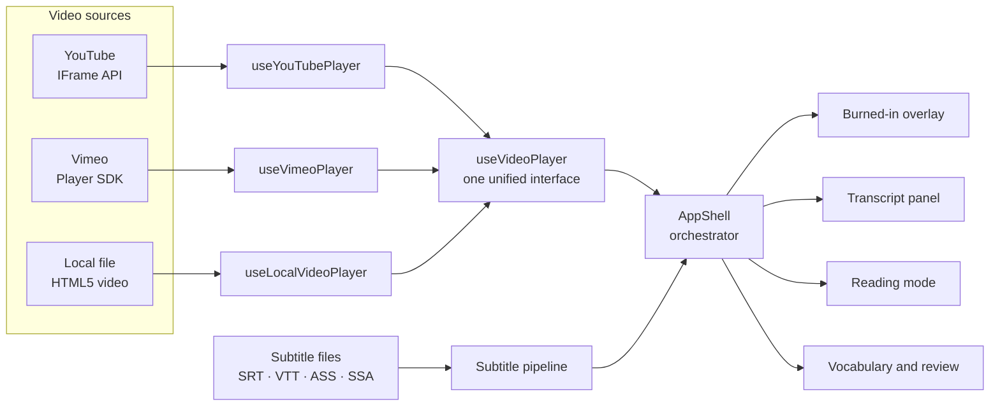
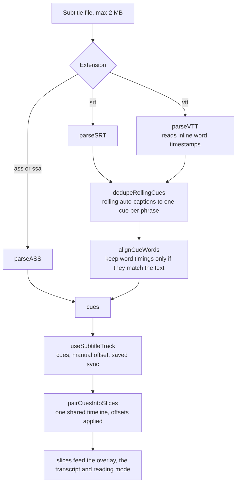
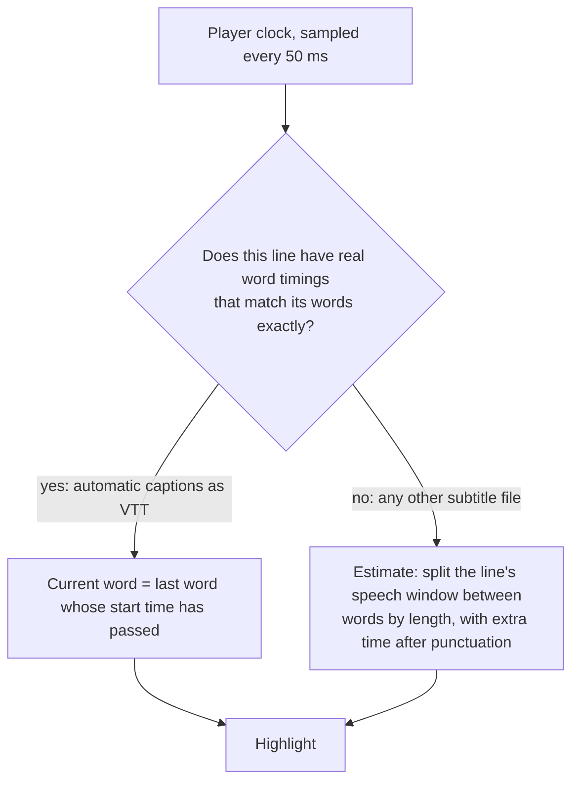
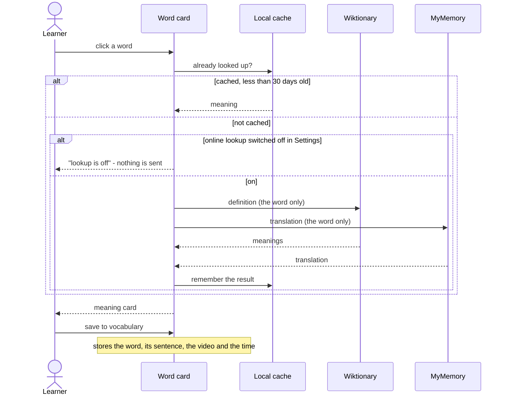

# DUAL_SUB — Features, architecture and project notes

> Every feature, how the pieces fit together, the tech stack, privacy and security, testing, deployment,
> lessons learned and known limitations.

---

## Features

### 🎬 Dual-subtitle player

- **Three sources:** YouTube (through `youtube-nocookie.com`), Vimeo, or a local video file played from a `Blob` URL that never uploads anywhere.
- **Formats:** SRT, VTT, ASS and SSA, plus a **bilingual single file** (two lines per cue, split into both tracks automatically). Files are validated by extension and capped at 2 MB.
- **Independent tracks:** each language has its own colour, size, line height and width. Each burned-in line **drags on its own** anywhere inside the video, and one button moves the whole block between the bottom, middle and top of the picture (double-click a line to send it back).
- **Pick one language:** one tap on the video cycles *both → translation only → source only*; the sidebar and reading-mode toggles name the languages (`[ AR ]`, `[ EN ]`) instead of a generic "source / translation".
- **Words on the video:** click a word of the translation line to see its meaning in a card over the picture (a bottom sheet on phones, `Esc` closes it) — the same lookup, cache, vocabulary list and privacy switch as the sidebar. Press-and-drag still moves the line; only a click opens the card.
- **Sync control:** nudge each track in small steps, or use **two-point sync** to fix subtitles that drift (frame-rate mismatches). Offsets are remembered per video and file.
- **Synchronized transcript:** every line is a card with its timestamp; the current one is highlighted and kept in view, search finds text in either language, and clicking a line jumps to it.
- **Study tools:** recall mode (hide the translation until you ask), shadowing mode (auto-pause after every line), repeat the current line 2–4 times, bookmarks, text-to-speech with a voice picker, playback speed up to 2×.
- **Everywhere:** keyboard shortcuts for everything, touch gestures, Picture-in-Picture, Media Session (lock-screen controls), fullscreen, resumes where you stopped.

### 📖 Reading mode — lyrics for any video

Press **`T`** (or the book icon). The transcript becomes a list of cards that follows the audio:

- **The word being spoken is highlighted.** YouTube's automatic captions saved as `.vtt` carry the start time of every word and are followed exactly; any other file has no per-word timing, so the highlight is **estimated** from word length and pauses at punctuation.
- Foreign text large, your language below it; swap them, hide timestamps, resize the text, switch between *source / translation / both / recall*.
- ±10 s, previous/next line, **0.25× speed steps**, and a **repeat this line** loop.
- **Copy** one line or the whole transcript (both languages, or only one).
- **Search** the text; handles videos with thousands of lines — only the cards near the screen exist in the DOM.
- Click a word for its meaning, read a line aloud with your device's voice, bookmark it.
- Keeps the screen awake while playing. Local files can be played as audio only.

### 🎓 Vocabulary that sticks

- Click any word → meaning and translation (Wiktionary + MyMemory) → **save it with the sentence, video and time** it came from.
- **Spaced-repetition review** (Leitner boxes) with fill-in-the-blank cards, answer grading with the next interval shown, and a button that jumps to the exact moment in the video.
- A **daily goal** (10 reviews) and a **streak** that counts a day after one minute of watching *or* five reviews.
- **Export** to CSV, or to an **Anki Cloze** file (the sentence with `{{c1::word::translation}}` and a link to the exact YouTube moment).

### 🧰 Getting and fixing subtitles

- **Drop or paste** subtitle files — or the subtitle *text* itself — anywhere on the page.
- **Auto-captions cleaned up:** YouTube's "rolling" captions (every cue repeating the previous line) collapse to one clean cue per phrase.

### 🔒 Your data, your device

- **Watch history** with progress, saved sync offsets and (optionally) the subtitle files themselves in IndexedDB, restored next time.
- **Backup & restore** everything to one JSON file; learning stats, vocabulary and settings included.
- Installable **PWA**; works offline once loaded (video itself aside).

### ♿ Accessible by construction

- Dark and light themes designed separately (not inverted), system preference respected, `prefers-reduced-motion` honoured.
- Semantic HTML, visible focus, labelled controls, focus-trapped dialogs, full keyboard operation.
- Reading mode is checked with **axe-core in real Chrome** (WCAG 2 A/AA, including colour contrast) in both themes and on phone and desktop sizes.

<details>
<summary><b>Keyboard shortcuts</b></summary>

| Key | Action | Key | Action |
| --- | --- | --- | --- |
| `Space` | Play / pause | `T` | Open / close reading mode |
| `←` `→` | Previous / next line | `S` | Shadowing mode on / off |
| `↑` `↓` | Volume | `R` | Reveal translation (recall mode) |
| `C` `X` `Z` | Faster / slower / reset speed | `B` | Bookmark the current line |
| `F` | Fullscreen | `/` | Focus the transcript search |
| `0` `1` `2` `3` | Restart line / repeat 2× / 3× / 4× | `?` | Show the shortcuts panel |

</details>

---


---

## How it works

### The big picture

Three different video players are hidden behind **one interface**, so everything above them (subtitles, transcript, reading mode, shortcuts) is written once.



`AppShell` owns the state and passes it down; it deliberately has no business logic of its own. Pure logic (parsing, pairing, timing, scheduling, formatting) lives in `src/lib/` as small functions with their own tests, and stateful behaviour lives in single-purpose hooks.

### The subtitle pipeline



- **Pairing.** The source track is the *backbone* (the translation track takes over if the source is empty); every slice takes the other track's cue that is active at the middle of the backbone cue. Looking up the active cue is a binary search (`O(log n)`), so long videos stay cheap.
- **Offsets.** Each track has its own manual offset, applied *after* parsing so the original times are never lost.
- **Rolling captions.** YouTube auto-captions repeat the previous line in every cue and add tiny 10 ms "bridge" cues. The cleaner only activates on files that really look like that, so ordinary repeated lines ("No." / "No.") are left alone.

### How the highlighted word is chosen



A wrong highlight is worse than none, so real timings are only used when they cover exactly the words on screen, in order, with times that never go backwards. Otherwise the estimate takes over silently.

### Reading mode internals

- **Only the active line polls the clock.** Every other card is plain, memoized markup; the list re-renders when the *current line* changes, not on every tick.
- **Virtualized list.** A 2-hour video has thousands of lines. Rendering all of them took ~4 s and ~108,000 DOM nodes at 3,000 lines; rendering only the cards near the screen takes ~150 ms and ~870 nodes, whatever the length *(measured in headless Chrome with software rendering, so absolute numbers are pessimistic; the scaling is what matters)*.
- **Staying centred with moving heights.** Card heights are estimated until measured. After a long jump the view keeps re-centring the current card until it has stayed put for a few frames, instead of trusting the first estimate.
- **No fighting the user.** Wheel and touch input pause auto-follow; a "back to current line" button resumes it.

### Looking up a word



### Spaced repetition

A small, predictable [Leitner system](https://en.wikipedia.org/wiki/Leitner_system): the better you know a word, the longer it stays away.

| Box | 0 (new / forgotten) | 1 | 2 | 3 | 4 | 5 |
|---|---|---|---|---|---|---|
| Comes back after | 10 minutes | 1 day | 3 days | 7 days | 14 days | 30 days |

*Didn't remember* → box 0. *Remembered* → one box up. *Easy* → two boxes up. The buttons show the interval each answer would give. A malformed review record in storage counts as "never reviewed" instead of crashing.

### Where data lives

Everything is local. The keys below are the complete list of what the app stores, and the backup file contains exactly these.

| What | Where |
| --- | --- |
| Display settings, theme, sidebar layout, reading preferences | `localStorage` |
| Watch history and playback position | `localStorage` |
| Sync offsets (per video and file) | `localStorage` |
| Vocabulary (with sentence context and review state) | `localStorage` |
| Bookmarks, learning stats, review counts | `localStorage` |
| Subtitle files for watch history | `IndexedDB` |
| Word lookup cache (200 words, 30 days; *not* included in backups) | `localStorage` |

Stored data is treated as **untrusted** (it can come from an old version, hand editing, or a restored backup): the readers that matter validate what they load and fall back to defaults.

---


---

## Tech stack

| | Technology | Version | Why it is here |
| --- | --- | --- | --- |
|  | **React** | 18.3 | Component model; hooks keep each behaviour in one small unit |
|  | **TypeScript** | 5.9 | Strict types across the whole code base, including tests |
|  | **Vite** + `vite-plugin-pwa` | 7.3 | Fast builds, code splitting, service worker and manifest |
|  | **Tailwind CSS** | 3.4 | Design tokens as CSS variables → two real themes, logical properties for RTL |
| 🎞️ | **Framer Motion** | 11.18 | Purposeful, subtle motion; disabled for `prefers-reduced-motion`. Loaded through `LazyMotion` (`m.*` components): the animation engine arrives in a separate chunk after the first paint |
| 🧭 | **Lucide React** | 0.454 | Consistent icon set |
| 📜 | **TanStack Virtual** | 3.14 | Reading-mode list with variable-height rows |
|  | **Vitest** + Testing Library + jsdom | 4.1 | Fast unit and integration tests |
| 🌐 | **puppeteer-core** + **axe-core** | 25.12 / 4.14 | Real-Chrome checks of layout, accessibility and CSP |
|  | **ESLint** | 8.57 | Zero-warning lint policy (see [roadmap](#known-limitations-and-roadmap)) |
|  | **GitHub Actions** | — | CI (lint, tests, build, real-browser check) and Pages deployment |

Runtime dependencies are deliberately few: React, React DOM, Framer Motion, Lucide, TanStack Virtual and `clsx`. There is no state-management library, no router, no UI kit and no HTTP client.

**Fonts** are self-hosted IBM Plex Sans, Sans Arabic and Mono (no request to a font CDN); their SIL Open Font Licence texts are in `public/fonts/LICENSES/`. Sans and Mono are split by `unicode-range` (Latin, Latin-extended, Cyrillic, Greek, symbols), so a normal visit downloads only the Latin part; `src/lib/deploy/fontFiles.test.ts` checks that every file the stylesheet names exists and that none is left unused.

---


---

## Project structure

```
.
├── src/
│   ├── components/
│   │   ├── layout/        AppShell (orchestrator), header, resizable panels
│   │   ├── video/         stage, control bar, subtitle overlay, gestures, stats card
│   │   ├── console/       transcript list, cards, glossary, word card, upload rows
│   │   ├── reading/       reading mode: cards, dock, tools, now-playing card
│   │   ├── subtitles/     draggable subtitle lines, clickable words, quick controls, sync controls
│   │   ├── settings/      settings, backup, storage usage, voice picker
│   │   ├── system/        error boundary, drop overlay
│   │   └── ui/            generic, reusable primitives only
│   ├── hooks/             one behaviour per hook (players, clocks, persistence, shortcuts…)
│   ├── lib/
│   │   ├── subtitles/     parsers, pairing, rolling-caption cleanup, word timing, sync maths
│   │   ├── utils/         storage, backup, vocabulary, review scheduling, exports, lookup
│   │   ├── csp/ deploy/   build-time helpers (security policy, base path, share URLs)
│   │   └── youtube/ …     URL parsing and player adapters
│   ├── context/           theme, subtitle settings, current video key
│   ├── constants/ types/  tokens, shortcuts, storage keys, shared types
│   └── __tests__/         integration tests (whole app in jsdom)
├── e2e/                   real-Chrome check: axe (WCAG), CSP violations, layout
├── public/                icons, fonts, _headers, robots.txt, og-image
├── docs/images/           the four screenshots shown in the README (WebP)
├── .github/workflows/     ci.yml, deploy.yml
├── vite.config.ts         build, PWA, CSP and share-metadata plugins
├── vercel.json  .vercelignore  netlify.toml  .nvmrc
└── CLAUDE.md  .claude/    project conventions (also read by AI coding assistants)
```

About **14,100 lines** of source in 166 files and **8,500 lines** of tests in 104 files.

---


---

## Privacy and security

| | |
| --- | --- |
| **No server** | There is no backend, database, login or analytics. Subtitle files and local videos are processed in the browser and never uploaded. |
| **One outgoing feature** | Clicking a word sends *that word only* to **Wiktionary** and **MyMemory**. It is on by default, can be switched off in *Settings → Privacy*, and results are cached on your device so repeated words send nothing. |
| **Content-Security-Policy** | Added to the production build: scripts only from the app itself (the small inline theme script is allowed by hash, not by `unsafe-inline`), network requests only to the two dictionary services, embeds only from YouTube and Vimeo. A real-Chrome test fails the build on any violation. |
| **Untrusted input everywhere** | Subtitle text is rendered through React (no raw HTML path). Exports guard against spreadsheet formulas and stray tabs/newlines. The share-URL settings are validated against strict patterns, so a crafted setting can never reach the HTML. |
| **Stored data is validated** | Reading preferences, review state, saved sentence context, learning stats and restored backups are checked when read, and settings are merged with defaults, so a bad value falls back instead of crashing. |
| **Privacy-friendly embeds** | YouTube plays through `youtube-nocookie.com`. |
| **Dependencies** | `npm audit --omit=dev`: **0 vulnerabilities**. The remaining dev-only advisories (denial-of-service in glob and CSS-selector parsing) sit in the Tailwind 3 build toolchain and only matter if the build processes untrusted patterns or CSS, which this project does not. |

> Only load subtitle files you have the right to use. This tool does not distribute any content.

---

## Deployment

The build is a folder of static files (`dist/`); any static host works and the configuration is included.

| Host | How |
| --- | --- |
| **Vercel** | Import the repository, see below |
| **GitHub Pages** | Settings → Pages → Source: **GitHub Actions**, then push to `main` (`.github/workflows/deploy.yml` tests, builds with the right `BASE_PATH` and publishes) |
| **Netlify** | Import the repository: `netlify.toml` sets everything and the headers come from `public/_headers` |
| **Cloudflare Pages** | Build command `npm run build`, output `dist` |

### Vercel

1. Push the repository to GitHub, GitLab or Bitbucket.
2. In Vercel choose **Add New → Project** and import it. Vercel recognises the Vite project; `vercel.json` sets the install command (`npm ci`), the build command (`npm run build`), the output folder (`dist`) and the security and caching headers. Leave *Root Directory* empty.
3. Click **Deploy**. No environment variable is required.

From a terminal: `npx vercel` for a preview and `npx vercel --prod` for production. `.vercelignore` keeps that upload down to what the build needs.

| Setting | Notes |
| --- | --- |
| **Node.js** | `package.json` pins `engines.node` to `22.x`, which overrides the project setting, so builds do not jump to a newer major by themselves. |
| **`SITE_URL`** (optional) | Link previews need absolute share-image URLs. On Vercel the build derives them from the variables Vercel provides (`VERCEL_PROJECT_PRODUCTION_URL` for production, `VERCEL_URL` for previews; keep *Automatically expose System Environment Variables* on). Set `SITE_URL=https://your-domain.com` only to override that. |
| **`BASE_PATH`** | Leave it unset on Vercel: the app is served from the domain root. It is for GitHub Pages project sites (for example `/dual-subs/`). |
| **Headers** | `frame-ancestors 'none'`, `X-Content-Type-Options`, `X-Frame-Options`, `Referrer-Policy`, `Permissions-Policy`; one year `immutable` caching for `/assets/*`, 30 days for `/fonts/*`, and `no-cache` for `index.html`, `sw.js`, `registerSW.js` and the manifest so updates reach visitors. `src/lib/deploy/hostConfigs.test.ts` keeps them identical to `public/_headers`. |
| **Routing** | The app has no client-side router, so no rewrite rules are needed. |

> Never set `Referrer-Policy: no-referrer`: YouTube embeds then refuse to play (error 153).

### Performance

Measured on a local production build in headless Chromium (cache disabled, first visit to the start screen): about 403 KB transferred in 15 requests, of which 107 KB (gzip) is the JavaScript needed for the first paint. Animation code (`LazyMotion`), the non-Latin font parts and the share image are loaded only when needed, and the service worker installs with 878 KiB instead of 1.8 MiB.

---

## Testing and quality

Three layers, each catching what the one below cannot:

| Layer | Tooling | What it is for |
| --- | --- | --- |
| **Unit** | Vitest | Pure logic: parsers, pairing, timing, scheduling, export formats, helpers |
| **Integration** | Vitest + Testing Library + jsdom | The whole app: upload, sync, reading mode, vocabulary, backup |
| **Real browser** | puppeteer-core + axe-core | Everything jsdom cannot see: layout, scrolling, colour contrast, CSP |

At the time of writing: **641 tests in 98 files**, all passing, plus **4 real-Chrome scenarios** (dark/light × desktop/phone) with 0 accessibility violations and 0 CSP violations. The same checks also pass when the app is served from a sub-folder (`BASE_PATH=/dual-subs/`), including service-worker registration and the manifest.

The real-browser check runs against the **production build** and verifies, among other things, that a short subtitle never wraps onto two lines and never sits underneath the control bar.

```bash
npm run typecheck && npm run lint && npm test && npm run build && npm run e2e
```

CI (`.github/workflows/ci.yml`) runs exactly that on every push and pull request.

---

## Lessons learned

Notes from building and hardening this project. Most of them cost something to learn.

**1. Measure before you optimise — then keep the number.**
Reading mode had no limit on video length, so it was measured before anything was changed: 3,000 lines took ~4 s to open and created ~108,000 DOM nodes, growing linearly with the length of the video. The cost was creating the nodes, so only rendering fewer of them could fix it. Virtualizing the list brought it to ~150 ms and ~870 nodes, flat; memoizing harder would only have shaved a constant factor.

**2. jsdom cannot see the bugs users see.**
Every one of these passed hundreds of unit tests and was found only in a real browser: the list opened scrolled to the top instead of the current line (a "reset scroll when the search changes" effect also ran on first render); the burned-in subtitle always wrapped its last word onto a second line (a percentage `max-width` on a box that is only as wide as its longest line, so that line must always be narrower than itself); subtitles were painted *under* the always-visible control bar; the elapsed/total time showed reversed in right-to-left pages; and upcoming words in the light theme had a 2.65:1 contrast. Layout, scrolling, bidirectional text and colour need a real engine, so those checks now live in `e2e/`.

**3. A test that cannot fail proves nothing.**
Before trusting a regression test, break the code on purpose and watch it fail. One of those tests *passed with the bug put back*: a newer mechanism silently repaired the damage after it happened, so the test only saw the repaired state. It was rewritten to count the offending calls instead of inspecting the final state.

**4. Re-check your own claims.**
An earlier note said fill-in-the-blank cards would fail for inflected words (*läuft* vs *laufen*). Reading what is actually saved showed the opposite: the word is stored exactly as clicked in the sentence, so the blank always works. It is now locked in by a test through the real click-and-save path instead of an assumption.

**5. Platform rules are product requirements.**
YouTube's terms forbid playing a video's audio without showing the player, so "audio only" is offered for local files only, and in YouTube/Vimeo reading mode the video stays visible (large, beside the text). Design around the rule early; retrofitting it later changes the whole layout.

**6. Estimate honestly, and prefer real data when it exists.**
Subtitle files have no per-word timing, so the highlight is an estimate from word length. When a file *does* carry real timings (YouTube auto-captions as VTT), they are used — but only if they match the displayed words exactly. A confidently wrong highlight is worse than an approximate one.

**7. Accessibility lives in the design system, not in a checklist.**
The accent colour is *derived from the user's subtitle colour*, so it can never be guaranteed readable as text. The fix was a rule (accent for borders and fills, never for text) plus per-theme colour adjustment, not a one-off tweak. The first fix also changed *how progress is shown* — brightening what was read instead of dimming what is upcoming — because dimming cannot meet contrast in a light theme at any opacity.

**8. Right-to-left is more than `dir="rtl"`.**
Logical CSS properties (`start`/`end`) and a mirrored layout are the easy half. The traps are numbers: inside Arabic text, `0:15 / 0:30` renders as `0:30 / 0:15` unless forced left-to-right, and native sliders reverse direction. Test the strings, not just the layout.

**9. Treat everything stored as untrusted.**
`localStorage`, IndexedDB and restored backups can hold anything: older formats, hand edits, truncated JSON. Each reader validates and falls back, so a bad value shows up as "no data", never as a crash on start.

**10. Security is cheap when it is a default and expensive when it is a retrofit.**
The CSP has no `unsafe-inline` for scripts (the one inline script is allowed by hash and the hash is computed at build time); exports neutralise formula injection. The e2e run turns any future CSP violation into a failed build.

**11. Deployment is part of the code.**
Four small facts caused most of the work: a manifest with absolute `/` paths breaks under `/repo/`; a cached `sw.js` delays every update; `frame-ancestors` only works as a header; and `no-referrer` silently breaks YouTube embeds. Each now has a configuration, a test, and a comment explaining why.

**12. Small, verified steps beat big rewrites.**
Every change here was the smallest one that fixed the cause, tested first when possible, and run against the whole suite. The two things that were *not* done — a full interface translation and a Tailwind 4 upgrade — were left out on purpose: the first was counted (about 120 files and 400 test queries), the second is a breaking migration of the styling setup. Both deserve their own decision rather than a rushed one.

---

## Known limitations and roadmap

**Known limitations**

- **Interface language.** The UI is Arabic and right-to-left. Translating it touches roughly 120 source files and about 400 test queries and needs a decision on layout direction for LTR languages, so it is a project of its own.
- **Word timing** is exact only for YouTube automatic captions in `.vtt`; everywhere else it is an estimate.
- **YouTube and Vimeo** always show their player (terms of service); audio-only works for local files.
- **Subtitle sourcing.** The app has no server, so it cannot fetch YouTube captions: bring your own `.srt`, `.vtt` or `.ass` files.
- **Anki export** follows the file-header format of Anki 2.1.54+ and has not been tried against a real Anki installation.
- **Contrast outside reading mode:** the shared `text-muted` colour is below WCAG AA for small text; reading mode avoids it, the rest of the interface has not been audited.
- **Dev tooling:** ESLint 8 is deprecated upstream and Tailwind 3 pulls in dev-only advisories; both are tracked below.
- **Small screens.** Subtitle font sizes are fixed pixels (set in Settings), so on a phone a long line can fill most of the small video; the line under the video and the word card (a bottom sheet there) stay readable. Scaling the on-video text with the video size is a candidate improvement.
- **No cross-device sync.** Data stays on one device; use *Backup & restore* to move it.

**Roadmap**

- [ ] Interface translation (library vs. hand-rolled dictionary, LTR layout pass)
- [ ] ESLint 9 (flat config) and Tailwind 4 upgrades
- [ ] Axe checks for the vocabulary, settings and upload screens
- [ ] Automated test of Anki import with a real Anki
- [ ] Lemma-aware lookup for inflected forms

---

## Contributing

Issues and pull requests are welcome.

1. Fork and create a branch.
2. Read `CLAUDE.md` and `.claude/rules/` — they describe the conventions (small functions, no new runtime dependency without a reason, no backend, every bug fix ships with a test that fails without it).
3. Make the change, then run `npm run lint && npm test && npm run build && npm run e2e`.
4. Open a pull request describing the problem and how you verified the fix.

---

## License and credits

Released under the [MIT License](LICENSE).

- **[YouTube IFrame Player API](https://developers.google.com/youtube/iframe_api_reference)** and **[Vimeo Player](https://developer.vimeo.com/player)** for playback.
- **[Wiktionary](https://en.wiktionary.org)** (definitions) and **[MyMemory](https://mymemory.translated.net)** (translations) for the optional word lookup.
- **[IBM Plex](https://github.com/IBM/plex)** typefaces (Sans, Sans Arabic, Mono), used under the SIL Open Font License (see `public/fonts/LICENSES/`).
- **[Lucide](https://lucide.dev)** icons, **[TanStack Virtual](https://tanstack.com/virtual)**, **[Framer Motion](https://www.framer.com/motion/)**, **[axe-core](https://github.com/dequelabs/axe-core)** and **[Puppeteer](https://pptr.dev)**.
- The screenshots in the README show public German-learning videos from YouTube; the video content belongs to its creators.

<div align="center">
<br />
<sub>If this helps your language learning, a ⭐ on the repository is appreciated.</sub>
</div>

