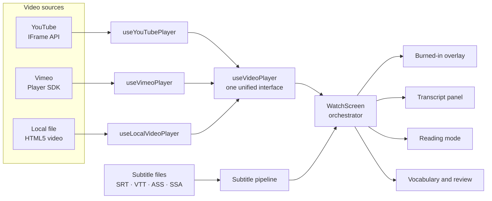
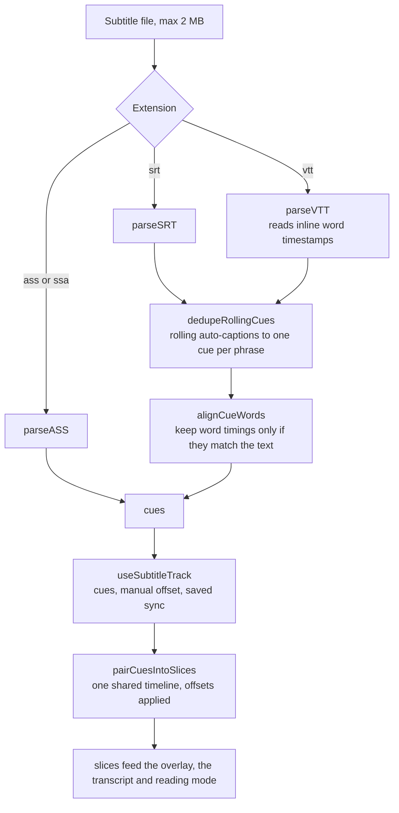
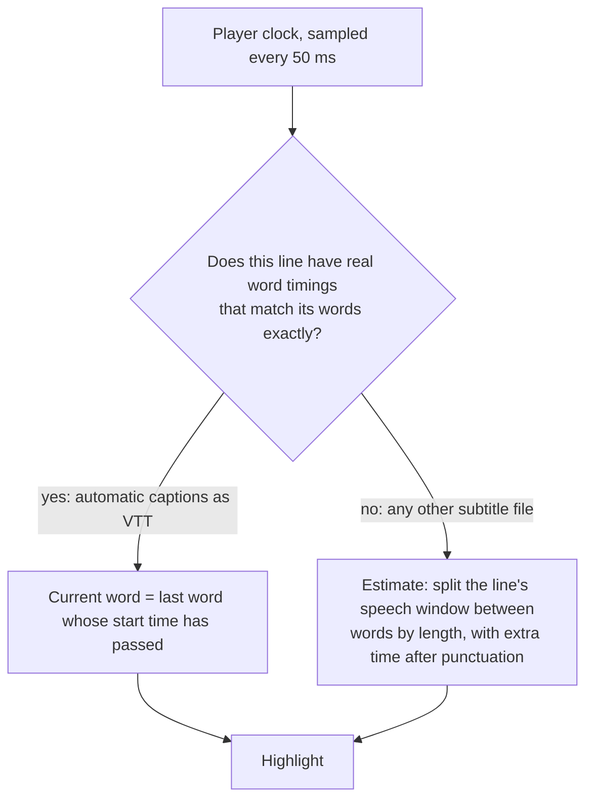
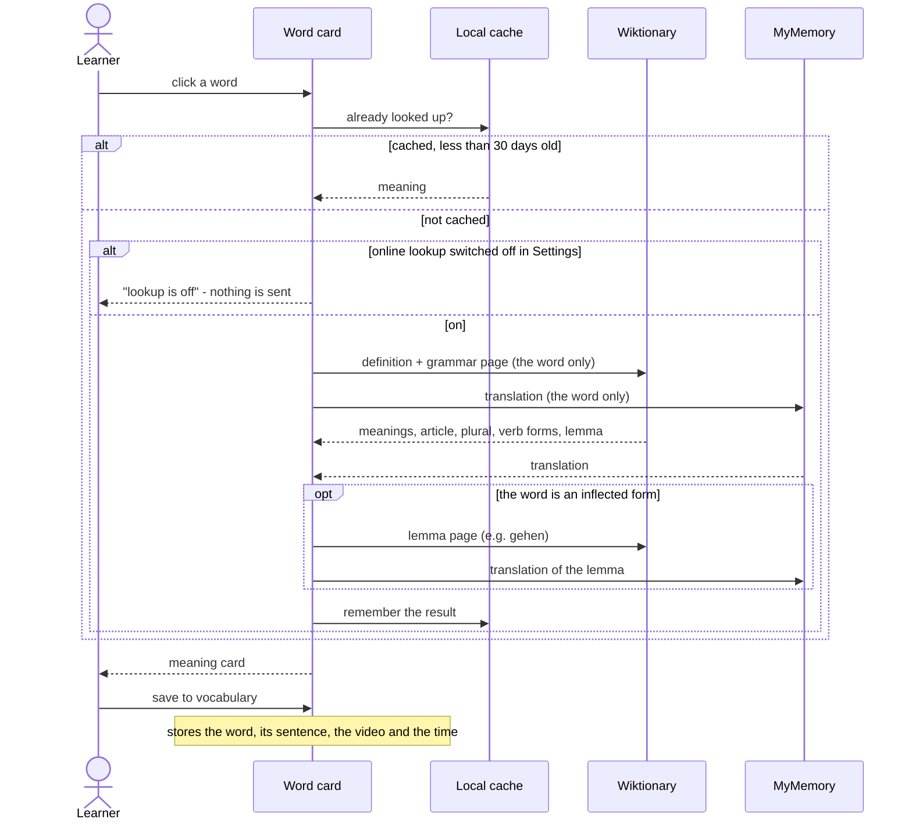

# DUAL_SUB — How it works

[← Architecture overview](../ARCHITECTURE.md)

## How it works

### The big picture

Three different video players are hidden behind **one interface**, so everything above them (subtitles, transcript, reading mode, shortcuts) is written once.

`AppShell` only keeps the chosen video source and shows the start screen; once a video is chosen it loads `WatchScreen` on demand, which owns the state and passes it down and deliberately has no business logic of its own. Going back to the start screen unmounts `WatchScreen`, which drops all of that state at once. Pure logic (parsing, pairing, timing, scheduling, formatting) lives in `src/lib/` as small functions with their own tests, and stateful behaviour lives in single-purpose hooks.

### The subtitle pipeline

- **Pairing.** The source track is the *backbone* (the translation track takes over if the source is empty); every slice takes the other track's cue that is active at the middle of the backbone cue. Looking up the active cue is a binary search (`O(log n)`), so long videos stay cheap.
- **Offsets.** Each track has its own manual offset, applied *after* parsing so the original times are never lost.
- **Rolling captions.** YouTube auto-captions repeat the previous line in every cue and add tiny 10 ms "bridge" cues. The cleaner only activates on files that really look like that, so ordinary repeated lines ("No." / "No.") are left alone.

### How the highlighted word is chosen

A wrong highlight is worse than none, so real timings are only used when they cover exactly the words on screen, in order, with times that never go backwards. Otherwise the estimate takes over silently.

### Reading mode internals

- **Only the active line polls the clock.** Every other card is plain, memoized markup; the list re-renders when the *current line* changes, not on every tick.
- **Virtualized list.** A 2-hour video has thousands of lines. Rendering all of them took ~4 s and ~108,000 DOM nodes at 3,000 lines; rendering only the cards near the screen takes ~150 ms and ~870 nodes, whatever the length *(measured in headless Chrome with software rendering, so absolute numbers are pessimistic; the scaling is what matters)*.
- **Staying centred with moving heights.** Card heights are estimated until measured. After a long jump the view keeps re-centring the current card until it has stayed put for a few frames, instead of trusting the first estimate.
- **No fighting the user.** Wheel and touch input pause auto-follow; a "back to current line" button resumes it.

### Looking up a word

### Spaced repetition

A small, predictable [Leitner system](https://en.wikipedia.org/wiki/Leitner_system): the better you know a word, the longer it stays away.

| Box | 0 (new / forgotten) | 1 | 2 | 3 | 4 | 5 |
|---|---|---|---|---|---|---|
| Comes back after | 10 minutes | 1 day | 3 days | 7 days | 14 days | 30 days |

*Didn't remember* → box 0. *Remembered* → one box up. *Easy* → two boxes up. The buttons show the interval each answer would give. A malformed review record in storage counts as "never reviewed" instead of crashing.

A session's queue is built by `getReviewQueue`: everything overdue first, then new words in the order they were saved. The learner's **new-words-per-session cap** (5 / 10 / 20 / 50 / none, default 20, key `ydc:review-new-limit`) limits only the new words, so a long list never hides a word that is overdue.

### Saved-word highlighting

`SavedWordsProvider` (mounted in `WatchScreen` with the language of the learned track) keeps one `Set` of saved words and dictionary forms. Every clickable word asks that set instead of reading storage, which matters in reading mode with thousands of lines. `glossaryStore` announces each change with a `ydc:glossary-changed` event (and other tabs through the `storage` event), so a word is underlined the moment it is saved. The switch lives in Settings (`ydc:highlight-saved-words`).

### Keyboard ownership

Video shortcuts live on `window`. While a modal panel (`aria-modal="true"`: settings, vocabulary, shortcuts help, voice picker) is open they stand down, otherwise the review's `1`/`2`/`3` would also repeat the scene and `Space` would pause the video behind the panel.

### Updates and connection

The service worker uses `registerType: 'prompt'`: a new version waits until the learner presses *Update now* in `PwaUpdatePrompt`, which avoids swapping files under an open page whose lazily loaded panels could then request chunks that no longer exist. The worker only calls `skipWaiting()` on the `SKIP_WAITING` message (checked in the built `sw.js`). `ConnectionBadge` in the header shows when the browser reports no connection.

### Where data lives

Everything is local. The keys below are the complete list of what the app stores, and the backup file contains exactly these.

| What | Where |
| --- | --- |
| Display settings, theme, sidebar layout, reading preferences | `localStorage` |
| Watch history and playback position | `localStorage` |
| Sync offsets (per video and file) | `localStorage` |
| Vocabulary (with sentence context and review state) | `localStorage` |
| Bookmarks, learning stats, review counts | `localStorage` |
| Subtitle files for watch history | `IndexedDB` |
| Word lookup cache (200 words, 30 days, versioned so older entries without grammar are refetched; *not* included in backups) | `localStorage` |

Stored data is treated as **untrusted** (it can come from an old version, hand editing, or a restored backup): the readers that matter validate what they load and fall back to defaults.
